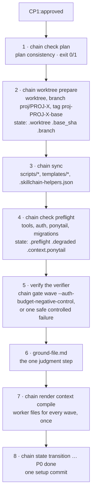

# How the Chain Works

Start here if you have not used the chain before. This page explains the part that is easy to miss from the skill list: **which steps are scripts that refuse to continue, and which are an agent's judgment**, and how a PROJ moves from the approved plan (P0) to the pull request (P8). The step-by-step skill roles are in [skill-chain.md](skill-chain.md); installation is in [installation.md](installation.md).

## Two layers

- **Skills** are written procedures an agent follows (concept, requirements, architecture, plans, executing, QA, docs, delivery). They decide things.
- **Scripts** are small deterministic programs the skills call. They record state, check gates, render documents and manage the worktree. They never decide anything; they either succeed or refuse.

Every script is reached through one entry point, **`chain <verb> [] [args…]`**. A synchronized repo has it at `scripts/chain` (`bash scripts/chain state get …`); before the first sync, call the installed copy `~/.claude/skills/5_executing/scripts/chain` (Codex: `~/.codex/skills/…`), which finds all helpers in the installed skills. `chain` only looks up the script and runs it unchanged: same arguments, same exit code, same output. Before the first sync, use the installed dispatcher instead of the repo copy. `chain --list` prints the table below, `chain --where <verb> []` prints the script it would run.

## The five script kinds

Every script belongs to exactly one kind. Only Records write state; Renderers write only their output documents (`chain render context` also refreshes the `skillchain-*` agent files); Gates answer with an exit code and a report.

| Kind | Contract | `chain` verbs → script |
|---|---|---|
| **Record** | The only way to write one file. Validates every write. | `chain state` → state.sh · `chain findings` → ledger.mjs · `chain findings harvest` → harvest-debt.sh (feeds `findings add`) · `chain quality` → quality-evidence.mjs |
| **Gate** | Refuses to continue: exit 0 or non-zero, report on stdout. | `chain gate wave` → wave-gate.sh · `chain quality seal` → quality-gate-proof.sh · `chain check plan` → plan.mjs · `chain check preflight` → preflight.sh · `chain check ponytail` → ponytail-check.sh · `chain check migrations` → migration-drift-check.sh · `chain check caps` → curation-caps.sh · `chain check intake` → intake-seal-check.sh · `chain check conflicts` and `chain check ci` → delivery.sh |
| **Renderer** | Turns data into a document. Never writes `state.json`, `findings.json` or `quality-*.json`. | `chain render context` and `chain render slice` → plan.mjs · `chain render registry` → gen-component-registry.mjs · `chain render pr` and `chain render report` → render.mjs |
| **Environment** | Changes the repo or the machine: worktree lifecycle, helper sync. | `chain worktree` → worktree.sh · `chain sync` → sync-framework.mjs |
| **Review** | Starts a reviewer from the opposite provider and normalizes what it returns. | `chain review` → cross-review.sh · `chain review claude` → review-with-claude.sh · `chain review codex` → review-with-codex.sh |

Stack-specific add-ons are separate scripts on purpose, so projects without that stack are unaffected: `chain check migrations` (Supabase projects), `chain render registry` (projects with a component library) and `chain check ponytail` (the Ponytail plugin). `chain check preflight` and `chain gate wave` call them when they apply.

Not behind `chain`: `env-local.sh` (a library the gates `source`), `merge-project-settings.sh` (Claude only, run once per project by hand), and the phase runner `runner/run-phase.sh`, which drives unattended runs.

## The phases at a glance

The state machine in `state.json` has the phases `CP1 → P0 → P5 → P6 → P7 → P8 → done`. Step 1 (concept) creates `state.json` with the PROJ folder; it stays `CP1:pending` through steps 1–4 until Checkpoint 1 approves the plan. The phase numbers P5–P8 follow the step numbers 5–8, and P0 is the setup that precedes step 5's implementation work.

| Phase | Call | Reads | Writes (its one writer) |
|---|---|---|---|
| **CP1** — approve the plan | `chain check plan`, `chain render context check`, then `chain state transition … CP1 approved` | wave plans, `wave-gate-config.json`, PRDs | `state.json` via `chain state` (phase, and the path of the decision log); the log itself, `decisions.md`, is written by the checkpoint subskill |
| **P0** — setup | see the P0 diagram below | the approved plans, `docs/` | worktree, `state.json`, `scripts/`, worker files |
| **P5** wave start | git tag `wave-N-start-PROJ-X`, `chain render context compile <X> <theme> --wave N` | the wave plan, `progress.md` | `context/workers/wave-N/*.md` |
| **P5** worker | reads its one file; `chain worktree with-shared-lock -- <cmd>` for migrations and auth commands | its worker file | code and tests |
| **P5** wave gate | `chain gate wave --ac-only N`, then `chain gate wave N`, then `chain state set … .waves` | code, `wave-gate-config.json` | `ralph-wave-N.json`, the `### Wave N Gate — PASSED` block in `progress.md` |
| **P5** quality gate | `chain quality <X> <theme> run build\|coverage\|sonar\|lint`, `chain quality <X> <theme> review <report>`, `chain quality seal` | build, tests, Sonar, the integration review | `5_progress/quality-*.json`, the `## Quality Gate` section in `progress.md`, then `chain state transition … P5 done` |
| **P6** — QA | `chain review qa`, `chain findings add` | the diff `BASE_SHA..HEAD`, PRDs, architecture | `findings.json`; the runner stores the finder's text report |
| **P7** — documentation | `chain check caps`, `chain review docs`, `chain state set … .authorship` | `docs/*`, `AGENTS.md`, the QA report | `docs/*` |
| **P8** — delivery | `chain check conflicts`, `chain findings harvest`, `chain findings auto-defer`, `chain findings stats`, `chain render pr`, `chain check ci`, `chain worktree cleanup` | `state.json`, `findings.json` | the PR body (rendered), `.pr` in `state.json`, the removed worktree |

## P0: one setup run

P0 runs once per PROJ, right after CP1. It is script-driven; the ground file is its single judgment step. There are no questions to the user.

The permission setup (`merge-project-settings.sh`, Claude only) is a separate manual one-time step.

## What a worker file contains

A worker reads exactly one compiled file, named by path in its spawn prompt. Nothing is pasted into prompts. `chain render context` writes one file per story, `context/workers/wave-N/<US-ID>.md` (`<US-ID>.backend.md` and `.frontend.md` for a contract split), and one per role without a story, `context/roles/wave-N/<role>.md` (reviewers and fix workers). Sections appear in this order:

| Section | Source |
|---|---|
| Header line: plan path, plan hash, role, wave | the wave plan `3-4_plan/PROJ-X-wave-N-plan.md` |
| Role rules | the role manifest `templates/roles/<role>.md` (preamble) |
| Project context for the role (its `inject` list) | `docs/PRODUCT.md`, `ARCHITECTURE.md`, `GUIDELINES.md`, `DESIGN-SYSTEM.md` or the security baseline, `ground-file.md` |
| PROJ architecture, filtered to the PRDs of the wave | the PROJ architecture document |
| API contracts of the wave | architecture and plan |
| `## Deine Story` (story files only: story, ACs, gate commands) | the wave plan, cut out verbatim by `chain render slice` |

The role comes from the `Agent Type` column of the wave plan. Micro-fixer and explore spawns get no file. Whole PRDs, other stories' plans, `progress.md` and `agent.md` files are never injected. A role over its token budget makes `compile` fail before anything is written.

## Three files, three writers

| File | Only writer | Never |
|---|---|---|
| `specs/PROJ-X-theme/state.json` — phase, status, worktree, preflight, cross-review rounds, PR | `chain state` (schema-checked, illegal phase transitions refused) | hand edits, raw `jq` writes |
| `specs/PROJ-X-theme/findings.json` — the findings ledger | `chain findings` (deduplicates, normalizes severity) | hand edits, raw `jq` writes |
| `specs/PROJ-X-theme/5_progress/quality-*.json` — command evidence of the quality gate | `chain quality` (records command, commit, input fingerprint, exit result, log hash) | fabricated evidence |

Reports and the PR body are rendered from these files by `chain render report` and `chain render pr`, never written or edited by hand. The reading side is free: any skill may read the three files.

## Which gate is a script, which a review

A gate is either a **script** (deterministic, same answer every time), an **LLM review** (a reviewer from the opposite provider, whose findings go into the ledger), or a **human** approval. The runner re-checks the script gates itself, so a writer cannot seal a phase past a red one.

| Gate | Kind | Call |
|---|---|---|
| Plan consistency (CP1, P0) | Script | `chain check plan` |
| Plan, concept, requirements, architecture review | LLM review | `chain review plan` (and the other modes) |
| Checkpoint 1 approval | Human | the checkpoint subskill; nothing is approved on the user's behalf |
| Tool and auth preflight, Ponytail parity, migration drift | Script | `chain check preflight` |
| Acceptance criteria per wave (Outer Ralph) | Script | `chain gate wave --ac-only N` |
| Wave gate: ACs, regressions, build, browser smoke | Script (CodeRabbit runs inside it as one input) | `chain gate wave N` |
| Integration review at the end of P5 | LLM review | a reviewer worker; its report is bound with `chain quality … review` |
| Quality gate evidence | Script | `chain quality seal` |
| QA: acceptance, security, six-persona panel | LLM review | `chain review qa` |
| No open Critical or High finding (P6, P8) | Script | `chain findings stats` |
| Documentation form (line caps) | Script | `chain check caps` |
| Documentation truth | LLM review | `chain review docs` |
| Intake baseline seal | Script | `chain check intake` |
| Merge conflicts against main | Script | `chain check conflicts` |
| CI on the final head | Script | `chain check ci` |
| Checkpoint 2 (PR review comments) | Human | the checkpoint subskill via delivery |

## Glossary

- **PROJ** — one numbered unit of work with its own concept, PRDs, architecture, plans, execution, QA and docs, under `specs/PROJ-<X>-<theme>/`.
- **CP1 / CP2** — Checkpoint 1 is the single human approval of the planning package before any code; Checkpoint 2 reconciles the review comments on the pull request.
- **P0 … P8** — the framework phases. P0 setup, P5 implementation, P6 QA, P7 documentation, P8 delivery. Each ends with a script-verified seal in `state.json` (`P5:done`).
- **Wave** — a dependency-ordered group of stories that can be built together. Wave N+1 starts only after wave N's gate passed.
- **Worker file** — the one compiled context file a worker reads (see above).
- **Ground file** — assumptions the plans rely on, each validated against the codebase, limited to what `docs/` does not already say.
- **Ralph** — the bounded verification loop. *Inner Ralph* is one self-review by each worker; *Outer Ralph* is the lead's wave-scoped pass over the acceptance criteria with four fixed recovery stages.
- **Quality Gate** — the PROJ-level gate after the last wave: declared quality commands, build, coverage, lint, Sonar and an integration review of `BASE_SHA..HEAD`, sealed by `chain quality seal`.
- **Ledger** — `findings.json`, the one deduplicated list of findings from every review source.
- **Cross-review** — a review by the opposite provider (a Claude author is reviewed by Codex and the reverse), started with `chain review`.
- **degraded** — set in `state.json` when Codex is missing or unauthenticated: the run continues single-provider with a model-opposite review, flagged in the morning report and the PR body, never silent.
- **BASE_SHA** — the commit the PROJ branch started from; QA and docs review the diff `BASE_SHA..HEAD`.
